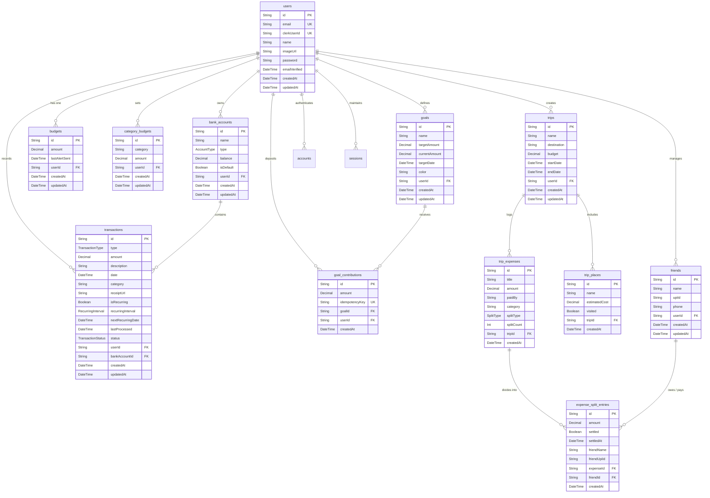

# 📊 Trakex (MoneyManager) — Project Data & AI Models Architecture

Comprehensive reference for all database models, entity relationships, enums, constraints, and AI models utilized across the Trakex application.

---

## 📑 Table of Contents
1. [Entity Relationship Diagram (ERD)](#-entity-relationship-diagram-erd)
2. [Database Models (Prisma ORM)](#-database-models-prisma-orm)
   - [User Management & Authentication](#1-user-management--authentication)
   - [Banking & Accounts](#2-banking--accounts)
   - [Transactions & Recurring Ledger](#3-transactions--recurring-ledger)
   - [Budgets & Thresholds](#4-budgets--thresholds)
   - [Savings Goals & Contributions](#5-savings-goals--contributions)
   - [Group Trips & Expense Splitting](#6-group-trips--expense-splitting)
3. [Enums Reference](#-enums-reference)
4. [AI Model Architecture (Gemini 2.5 Flash)](#-ai-model-architecture-gemini-25-flash)

---

## 🗺️ Entity Relationship Diagram (ERD)



---

## 🗄️ Database Models (Prisma ORM)

Source: [`prisma/schema.prisma`](file:///d:/Project/MoneyManager/MoneyManager/prisma/schema.prisma)

### 1. User Management & Authentication

#### `User` (`@@map("users")`)
Central entity holding user identity, security profile, and relational ownership.
| Field | Type | Attributes | Description |
|---|---|---|---|
| `id` | `String` | `@id @default(uuid())` | Primary unique identifier (UUID) |
| `clerkUserId` | `String?` | `@unique` | Optional ID for Clerk authentication |
| `email` | `String` | `@unique` | User email address |
| `name` | `String?` | | Display name of the user |
| `imageUrl` | `String?` | | Profile avatar image URL |
| `password` | `String?` | | Hashed password (for credential login) |
| `emailVerified`| `DateTime?`| | Email verification timestamp |
| `createdAt` | `DateTime` | `@default(now())` | Account creation timestamp |
| `updatedAt` | `DateTime` | `@updatedAt` | Profile update timestamp |

**Relations**:
* `bankAccounts`: `BankAccount[]` (Cascade delete)
* `transactions`: `Transaction[]` (Cascade delete)
* `budgets`: `Budget[]` (Cascade delete)
* `categoryBudgets`: `CategoryBudget[]` (Cascade delete)
* `goals`: `Goal[]` (Cascade delete)
* `goalContributions`: `GoalContribution[]` (Cascade delete)
* `trips`: `Trip[]` (Cascade delete)
* `friends`: `Friend[]` (Cascade delete)
* `accounts`: `Account[]` (NextAuth OAuth credentials)
* `sessions`: `Session[]` (NextAuth active sessions)

---

#### NextAuth Supporting Models
* **`Account` (`@@map("accounts")`)**: Stores linked OAuth accounts (Google, GitHub, etc.) with tokens (`access_token`, `refresh_token`, `id_token`).
* **`Session` (`@@map("sessions")`)**: Stores active user session tokens and expiry.
* **`VerificationToken` (`@@map("verification_tokens")`)**: One-time tokens for passwordless sign-in or email verification.

---

### 2. Banking & Accounts

#### `BankAccount` (`@@map("bank_accounts")`)
Stores individual bank accounts, cards, or digital wallets.
| Field | Type | Attributes | Description |
|---|---|---|---|
| `id` | `String` | `@id @default(uuid())` | Primary key |
| `name` | `String` | | Account label (e.g. "HDFC Salary", "Cash") |
| `type` | `AccountType` | | `CURRENT` or `SAVINGS` |
| `balance` | `Decimal` | `@default(0)` | Current account balance |
| `isDefault` | `Boolean` | `@default(false)` | Flag indicating primary default account |
| `userId` | `String` | `FK -> User.id` | Owner user ID (Indexed) |
| `createdAt` | `DateTime` | `@default(now())` | Creation timestamp |
| `updatedAt` | `DateTime` | `@updatedAt` | Last modification timestamp |

---

### 3. Transactions & Recurring Ledger

#### `Transaction` (`@@map("transactions")`)
Records every debit and credit transaction, with support for recurring intervals and receipt attachments.
| Field | Type | Attributes | Description |
|---|---|---|---|
| `id` | `String` | `@id @default(uuid())` | Primary key |
| `type` | `TransactionType` | | `INCOME` or `EXPENSE` |
| `amount` | `Decimal` | | Monetary transaction value |
| `description`| `String?` | | Note or memo for the transaction |
| `date` | `DateTime` | | Transaction occurrence timestamp |
| `category` | `String` | | Category key (e.g., `food`, `travel`, `bills`) |
| `receiptUrl` | `String?` | | Uploaded receipt image URL |
| `isRecurring` | `Boolean` | `@default(false)`| Whether transaction repeats automatically |
| `recurringInterval`| `RecurringInterval?` | | `DAILY`, `WEEKLY`, `MONTHLY`, `YEARLY` |
| `nextRecurringDate`| `DateTime?` | | Scheduled date for next recurring run |
| `lastProcessed` | `DateTime?` | | Timestamp when last recurrence executed |
| `status` | `TransactionStatus` | `@default(COMPLETED)`| `PENDING`, `COMPLETED`, `FAILED` |
| `userId` | `String` | `FK -> User.id` | Owner user ID (Indexed) |
| `bankAccountId` | `String` | `FK -> BankAccount.id` | Associated bank account ID (Indexed) |
| `createdAt` | `DateTime` | `@default(now())` | Record created timestamp |
| `updatedAt` | `DateTime` | `@updatedAt` | Record updated timestamp |

---

### 4. Budgets & Thresholds

#### `Budget` (`@@map("budgets")`)
Stores overall monthly budget allowance for a user.
| Field | Type | Attributes | Description |
|---|---|---|---|
| `id` | `String` | `@id @default(uuid())` | Primary key |
| `amount` | `Decimal` | | Total monthly budget threshold |
| `lastAlertSent` | `DateTime?` | | Timestamp of the last threshold alert email |
| `userId` | `String` | `@unique, FK -> User.id` | 1-to-1 mapping per user |
| `createdAt` | `DateTime` | `@default(now())` | Created timestamp |
| `updatedAt` | `DateTime` | `@updatedAt` | Updated timestamp |

#### `CategoryBudget` (`@@map("category_budgets")`)
Stores targeted budget thresholds per expense category.
| Field | Type | Attributes | Description |
|---|---|---|---|
| `id` | `String` | `@id @default(uuid())` | Primary key |
| `category` | `String` | | Category identifier |
| `amount` | `Decimal` | | Monthly allocated amount for this category |
| `userId` | `String` | `FK -> User.id` | Owner user ID |
| `createdAt` | `DateTime` | `@default(now())` | Created timestamp |
| `updatedAt` | `DateTime` | `@updatedAt` | Updated timestamp |

> **Constraint**: `@@unique([userId, category])` ensures a single budget target per category per user.

---

### 5. Savings Goals & Contributions

#### `Goal` (`@@map("goals")`)
Target savings goals with deadlines and progress tracking.
| Field | Type | Attributes | Description |
|---|---|---|---|
| `id` | `String` | `@id @default(uuid())` | Primary key |
| `name` | `String` | | Goal title (e.g. "Emergency Fund", "New Laptop") |
| `targetAmount` | `Decimal` | | Desired total target savings amount |
| `currentAmount`| `Decimal` | `@default(0)` | Current accumulated progress |
| `targetDate` | `DateTime` | | Target completion deadline |
| `color` | `String?` | | Hex color tag for UI charts |
| `userId` | `String` | `FK -> User.id` | Owner user ID (Indexed) |
| `createdAt` | `DateTime` | `@default(now())` | Created timestamp |
| `updatedAt` | `DateTime` | `@updatedAt` | Updated timestamp |

#### `GoalContribution` (`@@map("goal_contributions")`)
Atomic deposit or withdrawal ledger entry for a savings goal.
| Field | Type | Attributes | Description |
|---|---|---|---|
| `id` | `String` | `@id @default(uuid())` | Primary key |
| `amount` | `Decimal` | | Amount contributed (+ve) or withdrawn (-ve) |
| `idempotencyKey`| `String` | `@unique` | Unique key preventing double submission |
| `goalId` | `String` | `FK -> Goal.id` | Related goal ID (Indexed) |
| `userId` | `String` | `FK -> User.id` | Security check user ID (Indexed) |
| `createdAt` | `DateTime` | `@default(now())` | Timestamp of contribution |

---

### 6. Group Trips & Expense Splitting

#### `Trip` (`@@map("trips")`)
Group trip manager with budget tracking, itineraries, and expenses.
| Field | Type | Attributes | Description |
|---|---|---|---|
| `id` | `String` | `@id @default(uuid())` | Primary key |
| `name` | `String` | | Trip name (e.g. "Goa Vacation") |
| `destination` | `String` | | City / location destination |
| `budget` | `Decimal` | | Allocated trip budget |
| `startDate` | `DateTime?` | | Trip commencement date |
| `endDate` | `DateTime?` | | Trip conclusion date |
| `userId` | `String` | `FK -> User.id` | Organizer user ID (Indexed) |
| `createdAt` | `DateTime` | `@default(now())` | Created timestamp |
| `updatedAt` | `DateTime` | `@updatedAt` | Updated timestamp |

#### `TripPlace` (`@@map("trip_places")`)
Sightseeing and itinerary places associated with a trip.
| Field | Type | Attributes | Description |
|---|---|---|---|
| `id` | `String` | `@id @default(uuid())` | Primary key |
| `name` | `String` | | Place or activity name |
| `estimatedCost`| `Decimal` | `@default(0)` | Estimated ticket/activity cost |
| `visited` | `Boolean` | `@default(false)`| Visited checklist flag |
| `tripId` | `String` | `FK -> Trip.id` | Parent trip ID (Indexed) |
| `createdAt` | `DateTime` | `@default(now())` | Created timestamp |

#### `TripExpense` (`@@map("trip_expenses")`)
Shared expense logged during a trip.
| Field | Type | Attributes | Description |
|---|---|---|---|
| `id` | `String` | `@id @default(uuid())` | Primary key |
| `title` | `String` | | Expense title (e.g. "Dinner at Beach Hut") |
| `amount` | `Decimal` | | Total bill amount |
| `paidBy` | `String?` | | Who paid the upfront bill (e.g., "Me", "Rahul") |
| `category` | `String` | `@default("other-expense")` | Expense category |
| `splitType` | `SplitType` | `@default(NONE)` | `NONE` or `EQUAL` |
| `splitCount` | `Int?` | | Number of participants splitting the expense |
| `tripId` | `String` | `FK -> Trip.id` | Parent trip ID (Indexed) |
| `createdAt` | `DateTime` | `@default(now())` | Created timestamp |

#### `Friend` (`@@map("friends")`)
Participant contacts for group expense splitting with UPI payment settlement.
| Field | Type | Attributes | Description |
|---|---|---|---|
| `id` | `String` | `@id @default(uuid())` | Primary key |
| `name` | `String` | | Friend's name |
| `upiId` | `String?` | | UPI VPA address (e.g., `friend@okhdfcbank`) |
| `phone` | `String?` | | Phone number for payment/contact |
| `userId` | `String` | `FK -> User.id` | User managing this contact (Indexed) |
| `createdAt` | `DateTime` | `@default(now())` | Created timestamp |
| `updatedAt` | `DateTime` | `@updatedAt` | Updated timestamp |

#### `ExpenseSplitEntry` (`@@map("expense_split_entries")`)
Individual debt share calculation with UPI payment settlement status.
| Field | Type | Attributes | Description |
|---|---|---|---|
| `id` | `String` | `@id @default(uuid())` | Primary key |
| `amount` | `Decimal` | | Calculated share amount (in Paise math precision) |
| `settled` | `Boolean` | `@default(false)`| Whether the split payment has been settled |
| `settledAt` | `DateTime?` | | Timestamp of settlement |
| `friendName` | `String` | | Name snapshot of the participant |
| `friendUpiId`| `String?` | | UPI ID snapshot for deep-link / QR code payment |
| `expenseId` | `String` | `FK -> TripExpense.id`| Parent expense ID (Indexed) |
| `friendId` | `String?` | `FK -> Friend.id` | Linked friend record (Indexed, `onDelete: SetNull`) |
| `createdAt` | `DateTime` | `@default(now())` | Created timestamp |

---

## 🔢 Enums Reference

```prisma
enum TransactionType {
  INCOME
  EXPENSE
}

enum AccountType {
  CURRENT
  SAVINGS
}

enum TransactionStatus { 
  PENDING
  COMPLETED
  FAILED
}

enum RecurringInterval {
  DAILY
  WEEKLY
  MONTHLY
  YEARLY
}

enum SplitType {
  NONE
  EQUAL
}
```

---

## 🤖 AI Model Architecture (Gemini 2.5 Flash)

The application incorporates Google GenAI via `@google/generative-ai` ([actions/ai.js](file:///d:/Project/MoneyManager/MoneyManager/actions/ai.js)).

### Model Specifications
* **Active Model**: `gemini-2.5-flash`
* **Configuration**: `GEMINI_API_KEY` environment variable

### Capabilities & Pipelines
1. **Voice-to-Transaction Parser**:
   * Speech transcribed via Web Speech API.
   * Gemini extracts structured parameters: `{ amount, type, category, date, description, bankAccount }`.
2. **Smart Category Prediction**:
   * Predicts expense category from natural language transaction descriptions.
3. **Receipt Scanner & OCR**:
   * Parses images/receipts into merchant name, date, itemized amounts, and taxes.
4. **Context-Aware Financial Insights**:
   * Analyzes spending history, budget adherence, and recurring liabilities to provide personalized financial guidance.
5. **AI Trip Planner**:
   * Recommends places to visit, itinerary scheduling, and budget allocation based on destination.
